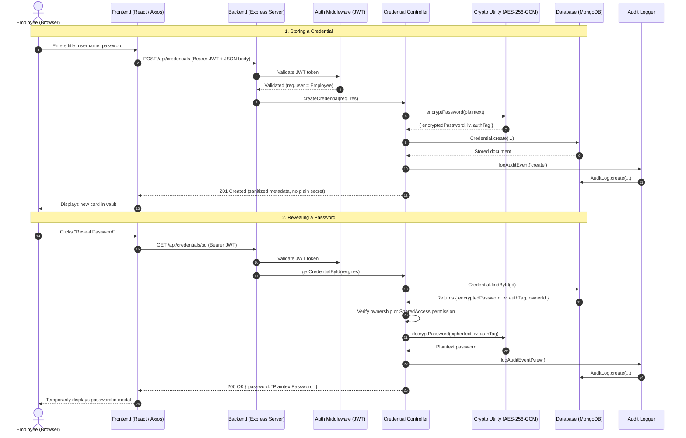

# 📦 SecureVault · Comprehensive Modules & Files Reference Guide

> **SecureVault** is an enterprise-grade, zero-knowledge credential management platform built on the **MERN** stack (MongoDB, Express.js, React 18, Node.js).  
> This document details the system architecture, breaks down each high-level module, and documents the exact responsibilities, functions, and data flows of every file in the project.

---

## 📑 Table of Contents
1. [High-Level Architecture & Module Overview](#1-high-level-architecture--module-overview)
2. [Frontend Module (`frontend/`)](#2-frontend-module-frontend)
   - [Core & Configuration Files](#core--configuration-files)
   - [Application State & API Services](#application-state--api-services)
   - [Components & UI Widgets](#components--ui-widgets)
   - [Application Pages & Views](#application-pages--views)
3. [Backend Module (`backend/`)](#3-backend-module-backend)
   - [Server Entry & Configuration](#server-entry--configuration)
   - [Routes](#routes)
   - [Controllers](#controllers)
   - [Middleware](#middleware)
   - [Security & Cryptography Utilities](#security--cryptography-utilities)
4. [Database Module (`database/`)](#4-database-module-database)
   - [Connection & Fallbacks](#connection--fallbacks)
   - [Data Models (Mongoose Schemas)](#data-models-mongoose-schemas)
   - [Database Seeding & Fixtures](#database-seeding--fixtures)
5. [Configuration Module (`config/`)](#5-configuration-module-config)
6. [Utilities & Scripts Module (`others/`)](#6-utilities--scripts-module-others)
7. [Documentation Module (`docs/`)](#7-documentation-module-docs)
8. [Root & Workspace Orchestrator Files](#8-root--workspace-orchestrator-files)
9. [End-to-End Request & Data Flow](#9-end-to-end-request--data-flow)

---

## 1. High-Level Architecture & Module Overview

```text
┌─────────────────────────────────────────────────────────────────────────────┐
│                       🌐 FRONTEND (React 18 + Vite)                         │
│  • Pages (Login, Vault, Health, Admin) • Contexts (Auth JWT)               │
│  • Components (Generator, Modals, Strength Meter) • Axios Services         │
└──────────────────────────────────────┬──────────────────────────────────────┘
                                       │ HTTPS / JSON REST (Bearer JWT)
                                       ▼
┌─────────────────────────────────────────────────────────────────────────────┐
│                      ⚙️ BACKEND (Node.js + Express.js)                      │
│  • Middleware (JWT Verification, RBAC, Validation, Central Error Handling)   │
│  • Controllers (Auth, Credentials, Sharing, Health, Admin)                  │
│  • Crypto Engine (AES-256-GCM cipher/decipher, IV generation, zxcvbn)       │
└──────────────────────────────────────┬──────────────────────────────────────┘
                                       │ Mongoose ODM / TLS
                                       ▼
┌─────────────────────────────────────────────────────────────────────────────┐
│                         🗄️ DATABASE (MongoDB Engine)                        │
│  • Collections: users, credentials, sharedaccesses, auditlogs              │
│  • Embedded MongoDB Memory Server fallback for instant zero-config setup     │
└─────────────────────────────────────────────────────────────────────────────┘
```

The codebase is organized into **6 primary modules**:
1. **`frontend/`**: Interactive single-page application providing employee vaults, password generator widgets, health diagnostics, and administrative dashboards.
2. **`backend/`**: Secure REST API layer enforcing authenticated sessions, input validation, role-based access, and cryptographic operations.
3. **`database/`**: Mongoose schemas, indexes, MongoDB connection logic with embedded in-memory database fallback, and demo seeder scripts.
4. **`config/`**: Centralized environment variable definitions and templates.
5. **`others/`**: Automated report updating, diagram rendering, and Postman API test collections.
6. **`docs/`**: Project presentations, evaluation reports, screenshots, and visual architectural diagrams.

---

## 2. Frontend Module (`frontend/`)

### Core & Configuration Files

| File Path | Primary Job / Responsibility |
|---|---|
| `frontend/index.html` | The Single Page Application entry HTML shell. Defines the document title, viewport meta tags, favicon link, and `<div id="root"></div>` mount point. |
| `frontend/vite.config.js` | Configuration file for the Vite build engine. Configures the `@vitejs/plugin-react` plugin and sets up a development proxy (`/api` -> `http://localhost:5000`) to prevent CORS issues in local development. |
| `frontend/package.json` | Manifest for frontend dependencies (React 18, React Router v6, Axios, Lucide React icons, zxcvbn entropy library) and build scripts (`dev`, `build`, `preview`). |
| `frontend/src/main.jsx` | React application bootstrapping entry point. Mounts the `<App />` root component to `#root` wrapped in React `StrictMode`. |
| `frontend/src/App.jsx` | Master routing tree using `react-router-dom`. Sets up routes (`/login`, `/register`, `/credentials`, `/health`, `/admin/*`), applies authentication guards (`<ProtectedRoute>`), and renders layout chrome (TopNavbar, Sidebar). |
| `frontend/src/index.css` | Global styling and design system. Defines modern CSS variables, glassmorphic card stylings, custom scrollbars, typography, and responsive grid layouts. |

---

### Application State & API Services

| File Path | Primary Job / Responsibility |
|---|---|
| `frontend/src/context/AuthContext.jsx` | React Context providing global user authentication state. Stores JWT token in `localStorage`, keeps active user profile (`id`, `name`, `email`, `role`), and exposes `login()`, `register()`, and `logout()` helpers. |
| `frontend/src/services/api.js` | Central Axios instance configured with `baseURL: '/api'`. Attaches an HTTP request interceptor that automatically injects the `Authorization: Bearer <token>` header on every outgoing API request. |
| `frontend/src/services/authService.js` | Encapsulates authentication HTTP requests: `loginUser()`, `registerUser()`, and `fetchCurrentUser()`. |
| `frontend/src/services/credentialService.js` | Handles credential CRUD and sharing API calls: `getCredentials()`, `createCredential()`, `revealPassword()`, `updateCredential()`, `deleteCredential()`, `shareCredential()`, `revokeShare()`, and `getColleagues()`. |
| `frontend/src/services/healthService.js` | Fetches personal credential health diagnostics: `getMyHealthSummary()`. Computes counts of weak, reused, and expiring passwords. |
| `frontend/src/services/adminService.js` | Handles administrative REST endpoints: `getAdminDashboardStats()`, `getAllUsers()`, `toggleUserStatus()`, `changeUserRole()`, `getOrgHealth()`, and `getAuditLogs()`. |

---

### Components & UI Widgets

| File Path | Primary Job / Responsibility |
|---|---|
| `frontend/src/components/common/TopNavbar.jsx` | Top application header displaying company branding, session indicators, active user profile pill, and the one-click Logout button. |
| `frontend/src/components/common/Sidebar.jsx` | Left navigation bar. Dynamically displays employee navigation links (Vault, Password Health) and privileged administrator links (Dashboard, Users, Org Health, Audit Logs). |
| `frontend/src/components/common/ProtectedRoute.jsx` | Route guard component. Verifies user is authenticated before loading protected routes; redirects unauthenticated users to `/login` and non-admins away from `/admin` routes. |
| `frontend/src/components/common/LiveStrengthMeter.jsx` | Real-time visual entropy meter. Evaluates password inputs using `zxcvbn` to calculate score (0–4), displaying color-coded progress bars (Very Weak to Very Strong) and instant feedback. |
| `frontend/src/components/credentials/CredentialDetailModal.jsx` | Modal dialog displaying stored credential details. Allows authorized users to click **Reveal** to trigger zero-knowledge backend decryption, copy password to clipboard, or navigate to login URLs. |
| `frontend/src/components/credentials/CredentialFormModal.jsx` | Modal form for creating and updating credentials (Service Title, Username/Email, Password, URL, Notes) integrated with the live password generator and strength meter. |
| `frontend/src/components/credentials/GeneratorWidget.jsx` | Interactive cryptographic password generator. Configurable length slider (8 to 64 chars) and toggles for uppercase, lowercase, numbers, and symbols. |
| `frontend/src/components/credentials/ShareModal.jsx` | Granular sharing dialog. Lists active colleagues in the organization, allows selecting view or edit permissions, and lists existing delegations with one-click revocation. |

---

### Application Pages & Views

| File Path | Primary Job / Responsibility |
|---|---|
| `frontend/src/pages/LoginPage.jsx` | Authentication screen. Provides email/password login form with demo account quick-fill buttons for immediate evaluation. |
| `frontend/src/pages/RegisterPage.jsx` | Employee onboarding screen. Enforces master password complexity using `LiveStrengthMeter` before account creation. |
| `frontend/src/pages/CredentialsPage.jsx` | Main personal vault dashboard. Lists owned and shared credentials with search, category filtering, reveal modals, edit controls, and share actions. |
| `frontend/src/pages/HealthPage.jsx` | Personal password hygiene report. Displays overall security score, highlights weak, reused, and aged (>90 days) credentials with direct remediation links. |
| `frontend/src/pages/AdminDashboardPage.jsx` | Executive security overview. Shows aggregate user counts, total credentials, average organization health score, and recent security events. |
| `frontend/src/pages/AdminUsersPage.jsx` | Employee directory and governance. Allows administrators to view all accounts, deactivate compromised employees, or promote/demote user roles. |
| `frontend/src/pages/AdminHealthPage.jsx` | Organization-wide security posture view. Analyzes employee password health aggregates and lists at-risk accounts without ever decrypting their actual passwords. |
| `frontend/src/pages/AdminAuditPage.jsx` | Tamper-evident compliance audit trail. Lists all system actions (`login`, `create`, `view`, `share`, `revoke`, `delete`) with actor identity, target credential, client IP, and timestamps. |

---

## 3. Backend Module (`backend/`)

### Server Entry & Configuration

| File Path | Primary Job / Responsibility |
|---|---|
| `backend/server.js` | Main Express server entry point. Sets up CORS, JSON body parsers, routes, centralized error handling, and statically serves production frontend builds. Automatically resolves `.env` from `config/.env` or `backend/.env`. |
| `backend/package.json` | Manifest for backend dependencies (`express`, `mongoose`, `bcryptjs`, `jsonwebtoken`, `express-validator`, `zxcvbn`, `mongodb-memory-server`) and dev scripts (`start`, `dev`, `seed`). |

---

### Routes

| File Path | Primary Job / Responsibility |
|---|---|
| `backend/routes/authRoutes.js` | Maps `/api/auth` endpoints: `POST /register`, `POST /login`, and `GET /me`. |
| `backend/routes/credentialRoutes.js` | Maps `/api/credentials` endpoints: `GET /` (list), `POST /` (create), `GET /:id` (decrypt/reveal), `PUT /:id` (update), `DELETE /:id` (delete), and `/api/credentials/:id/share` subroutes. |
| `backend/routes/healthRoutes.js` | Maps `/api/health` endpoints: `GET /me` (personal password health report). |
| `backend/routes/adminRoutes.js` | Maps `/api/admin` privileged routes guarded by `requireAdmin`: `GET /stats`, `GET /users`, `PATCH /users/:id/status`, `PATCH /users/:id/role`, `GET /health`, and `GET /audit-logs`. |

---

### Controllers

| File Path | Primary Job / Responsibility |
|---|---|
| `backend/controllers/authController.js` | Handles user registration, master password bcrypt hashing, login authentication, JWT token signing, and login audit log recording. |
| `backend/controllers/credentialController.js` | Handles credential lifecycle: encrypts passwords using AES-256-GCM before saving, decrypts passwords on explicit reveal request, checks permissions, and records audit logs. |
| `backend/controllers/shareController.js` | Manages credential sharing with colleagues: creates and updates `SharedAccess` records with `view` or `edit` permissions, verifies ownership, and handles revocation. |
| `backend/controllers/healthController.js` | Evaluates personal password health. Computes password strength, calculates password age, and detects password reuse using in-memory SHA-256 hashes without leaking plaintexts. |
| `backend/controllers/adminController.js` | Serves administrative metrics: aggregates organization credential health scores, manages user account states, and queries filterable audit trails. |

---

### Middleware

| File Path | Primary Job / Responsibility |
|---|---|
| `backend/middleware/auth.js` | JWT verification middleware (`authenticateToken`). Decodes `Bearer` token from `Authorization` header, verifies user account existence and active status, and binds `req.user`. |
| `backend/middleware/rbac.js` | Role-Based Access Control guard (`requireAdmin`). Rejects non-admin users with an HTTP 403 Forbidden error. |
| `backend/middleware/validate.js` | Input validation suite using `express-validator`. Enforces format rules for emails, passwords, URLs, and permissions. |
| `backend/middleware/errorHandler.js` | Centralized Express error handler. Catches unhandled exceptions, logs errors, and formats safe, standardized JSON error responses. |

---

### Security & Cryptography Utilities

| File Path | Primary Job / Responsibility |
|---|---|
| `backend/utils/crypto.js` | Cryptographic engine. Implements AES-256-GCM authenticated encryption (`encryptPassword`), decryption with authentication tag verification (`decryptPassword`), and cryptographically secure random password generation (`generateSecurePassword`). |
| `backend/utils/passwordHealth.js` | Evaluates password entropy and strength score (0 to 4) using `zxcvbn`, providing feedback suggestions and crack time estimates. |
| `backend/utils/auditLogger.js` | Compliance audit logger (`logAuditEvent`). Asynchronously writes immutable audit log entries (action, actor ID, credential reference, client IP, timestamp) to the `AuditLog` collection. |

---

## 4. Database Module (`database/`)

### Connection & Fallbacks

| File Path | Primary Job / Responsibility |
|---|---|
| `database/config/db.js` | MongoDB connection manager. Connects to `MONGO_URI`. If a local or remote MongoDB instance is unreachable, it automatically spawns an embedded **MongoMemoryServer** and seeds initial data so the app runs out-of-the-box. |

---

### Data Models (Mongoose Schemas)

| File Path | Primary Job / Responsibility |
|---|---|
| `database/models/User.js` | Schema for employee and administrator accounts (`name`, unique lowercase `email`, `masterPasswordHash`, `role`, `isActive`, `createdAt`). Includes `hashPassword()` and `comparePassword()` methods. |
| `database/models/Credential.js` | Schema for stored credentials (`ownerId`, `title`, `username`, `url`, `encryptedPassword`, `iv`, `authTag`, `strengthScore`, `lastUpdated`). Never stores plaintext passwords. |
| `database/models/SharedAccess.js` | Schema for shared credentials (`credentialId`, `sharedWith`, `sharedBy`, `permission: 'view'\|'edit'`, `createdAt`). Supports granular employee access delegation. |
| `database/models/AuditLog.js` | Schema for immutable compliance logs (`userId`, `action`, `credentialId`, `credentialTitle`, `details`, `ipAddress`, `timestamp`). Indexed on `timestamp` and `userId`. |

---

### Database Seeding & Fixtures

| File Path | Primary Job / Responsibility |
|---|---|
| `database/seed.js` | Self-contained seeder script. Populates demo administrator (`meera@company.com`), employee accounts (`aditya`, `rahul`, `sneha`, `kiran`), sample AES-256-GCM encrypted credentials, shared permissions, and realistic audit records. |
| `database/sample_data.json` | Static JSON reference containing sample datasets and initial fixtures for reference. |
| `database/README.md` | Dedicated documentation covering database schemas, indexes, connection options, and query examples. |

---

## 5. Configuration Module (`config/`)

| File Path | Primary Job / Responsibility |
|---|---|
| `config/.env` | Local environment variables file (PORT, NODE_ENV, MONGO_URI, JWT_SECRET, ENCRYPTION_KEY, CLIENT_URL). Ignored by Git for security. |
| `config/.env.example` | Committed template showing all required environment variables and format instructions for deployment. |

---

## 6. Utilities & Scripts Module (`others/`)

| File Path | Primary Job / Responsibility |
|---|---|
| `others/postman_collection.json` | Ready-to-import Postman collection (v2.1) covering all REST API endpoints for automated API testing and debugging. |
| `others/generate_diagrams.py` | Python script that uses Pillow to generate architectural, class, and sequence diagram PNGs for reports. |
| `others/update_report.py` | Python automation script that populates screenshots and diagrams into the Word project documentation report (`docs/SecureVault_Project_Report.docx`). |

---

## 7. Documentation Module (`docs/`)

| File Path | Primary Job / Responsibility |
|---|---|
| `docs/README.md` | Index of project documentation assets, presentations, and screenshots. |
| `docs/presentations/` | Slide decks used for academic and technical evaluations (Review 0, Review 1, and UI walkthroughs). |
| `docs/screenshots/` | Full-resolution UI screenshots of all pages (Login, Vault, Generator, Health, Admin, Audit). |
| `docs/diagrams/` | High-resolution architectural diagram, class diagram, and sequence flow diagrams. |
| `docs/SecureVault_Project_Report.docx` | Comprehensive formal project report document. |

---

## 8. Root & Workspace Orchestrator Files

| File Path | Primary Job / Responsibility |
|---|---|
| `package.json` | Root project orchestrator. Runs concurrent tasks (`npm run dev`), handles multi-module builds (`npm run build`), and runs seeding (`npm run seed`). |
| `SecureVault.code-workspace` | Multi-root Visual Studio Code workspace definition grouping Frontend, Backend, Database, and Project Root in the VS Code sidebar. |
| `.gitignore` | Configures Git to exclude sensitive files (`.env`, `config/.env`), dependencies (`node_modules/`), and build artifacts (`dist/`). |
| `render.yaml` | Cloud deployment configuration for hosting SecureVault on Render. |
| `README.md` | Main developer setup guide, quick-start manual, demo credentials, and architectural summary. |

---

## 9. End-to-End Request & Data Flow

Here is how the modules interact during a typical operation (e.g., adding and revealing an encrypted credential):



---

*Document generated for the SecureVault Credential Management Platform.*
